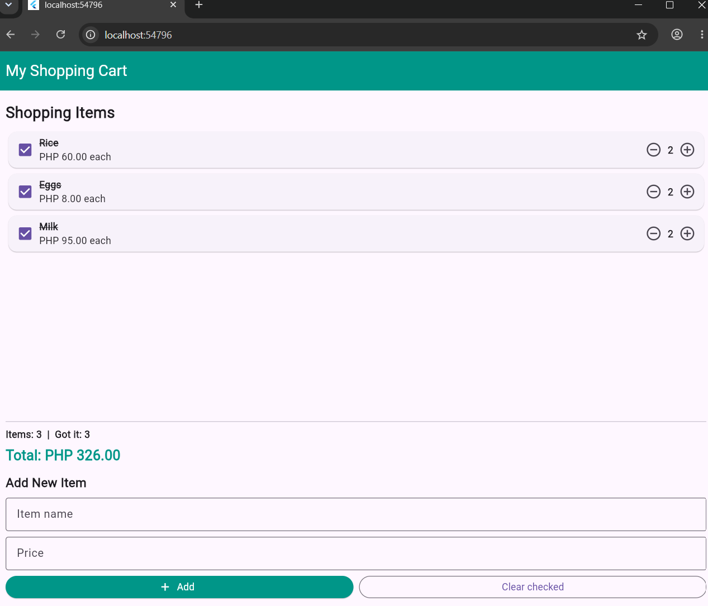

# Stateful Lab 3: Mini Shopping Cart

**Name:** Eunice Ann S. Galon

**Activity Title:** Laboratory Activity No. 3: Building a Mini Shopping Cart with StatefulWidget

## App Screenshot

## Features

- Displays shopping cart items.
- Increases and decreases item quantities.
- Marks items as checked.
- Calculates the total price automatically.
- Adds new items with name and price validation.
- Clears checked items and updates the total.
